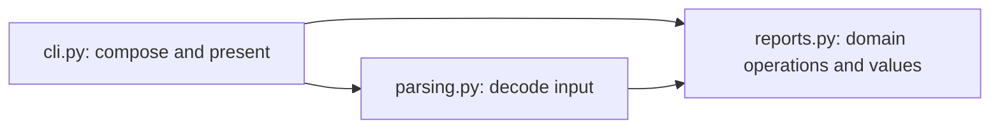

# API design

## Make the caller's contract clear

- Use this reference when designing functions, classes, modules, or compatible changes.
- Start with the caller's operation, required state, and observable effects.
- Choose an interface that hides implementation decisions without hiding important behavior.
- Prefer functions, ordinary objects, and coherent modules when they satisfy the contract.
- Add an abstraction when it simplifies real callers or isolates a changeable dependency.
- Keep project conventions unless they conflict with the requested behavior.

| Related decision | Read when needed |
| --- | --- |
| Records, annotations, and structural typing mechanics | [Types and validation](types-and-validation.md) |
| Shared objects, mutation, equality, and iteration | [State and iteration](state-and-iteration.md) |
| Errors and ownership of external resources | [Errors and resources](errors-and-resources.md) |
| Exported packages and public typing metadata | [Packaging and tooling](packaging-and-tooling.md) |
| Evidence for preserved behavior | [Verification and performance](verification-and-performance.md) |

## Choose a function or an object

| Need | Starting choice | Reason or limit |
| --- | --- | --- |
| Transform inputs into a result | Function | Inputs and outputs explain the operation without instance management. |
| Call a configurable operation | Function argument | A callback accepts functions, bound methods, closures, and callable objects. |
| Keep a small amount of local captured state | Closure | Keep capture and lifetime clear. Use an object when named state improves understanding. |
| Maintain related state and invariants | Class | Methods keep valid changes beside the state they affect. |
| Own a resource or lifecycle | Class or context manager | Make acquisition, use, and release explicit. |
| Group related stateless helpers | Module | A class used only as a namespace often adds unnecessary ceremony. |

- A class earns its place through meaningful behavior, state, identity, or lifecycle, not through a preferred pattern.
- Keep stateful objects when their state belongs together. Flattening their methods into functions can create hidden global dependencies.
- Use composition when one object delegates to another. Inherit when the subtype honors the base contract.
- A `staticmethod` can fit a class-specific operation that needs no instance. Compare it with a simpler module function.
- A `classmethod` can express an alternate constructor. Preserve subclass behavior when returning an instance through `cls`.

### A callback can gain state without changing its consumer

- The consumer below needs one operation with a simple positional signature.
- `Callable[[str], str]` accepts both implementations without a strategy base class.
- The callable object makes its accumulated count visible and keeps that state out of globals.

```python
from collections.abc import Callable, Iterable


def format_labels(labels: Iterable[str], formatter: Callable[[str], str]) -> list[str]:
    return [formatter(label) for label in labels]


def uppercase_label(label: str) -> str:
    return label.upper()


class PrefixFormatter:
    def __init__(self, prefix: str) -> None:
        self.prefix = prefix
        self._formatted_count = 0

    @property
    def formatted_count(self) -> int:
        return self._formatted_count

    def __call__(self, label: str) -> str:
        self._formatted_count += 1
        return f"{self.prefix}{label}"


print(format_labels(["arrival", "departure"], uppercase_label))
formatter = PrefixFormatter("Platform: ")
print(format_labels(["arrival", "departure"], formatter))
print(formatter.formatted_count)
```

- The count records completed formatter calls, not whether a later operation succeeds.
- Choose more explicit methods when an object offers several distinct operations without one natural call behavior.

## Choose the dependency contract

| Contract | Use when | Avoid when |
| --- | --- | --- |
| Concrete class | Its particular behavior or implementation is part of the requirement. | The consumer only needs a small, independent behavior. |
| Standard interface | `Iterable`, `Sequence`, `Mapping`, or another established interface matches the required operations. | The name suggests guarantees the implementation does not provide. |
| `Callable` | The consumer invokes one simple operation. | Keyword names, optional arguments, or overloads are essential to callback compatibility. |
| Custom `Protocol` | Independent implementations share a consumer-defined behavior. | It only mirrors one concrete class without simplifying a real dependency. |
| Abstract base class | An intentional inheritance family benefits from shared behavior or enforced abstract methods. | Unrelated implementations should work without adopting a base class. |

- Define a protocol around consumer needs, not around every method of an existing implementation.
- Keep related operations together when they form one useful contract. Protocol size has no universal quota.
- Shared code alone does not prove substitutability. Check mutation, failures, return values, and lifecycle expectations.
- An abstract base class can provide a template operation and require specific subclass methods.
- ABC registration does not inject missing methods or prove semantic correctness.
- Read [structural typing mechanics](types-and-validation.md#structural-contracts-without-inheritance) when writing protocol declarations or keyword-sensitive callbacks.

### Reuse Python's established behavior

- Implement `__iter__` for meaningful iteration, `__len__` for meaningful length, and indexing for meaningful indexed access.
- These operations let callers use ordinary loops, `len`, and standard library algorithms.
- Do not make a parser resemble a sequence merely to obtain familiar syntax.
- Honor the full behavior of a claimed interface. Indexing alone does not establish sequence semantics.
- Runtime behavior and static assignability differ.
- At runtime, iteration can fall back to integer `__getitem__` calls until `IndexError`.
- Static `Iterable` compatibility requires `__iter__`; a runtime fallback does not supply that member.
- Add an explicit `__iter__` when both runtime iteration and static iterable compatibility belong to the API.
- Read [iteration contracts](state-and-iteration.md) before changing consumption, repeatability, or evaluation timing.

## Keep attributes ordinary and operations visible

| Situation | Prefer | Why |
| --- | --- | --- |
| Simple public data | A public attribute | Callers need no ceremonial getter and setter pair. |
| Internal implementation state | A leading underscore | It marks an unsupported implementation detail, not a security boundary. |
| Cheap derived value | A property | Attribute access remains a useful mental model. |
| Controlled assignment | A property with a setter, when appropriate | Validation can preserve attribute syntax. |
| Remote I/O, expensive work, or surprising mutation | An explicit method | The call makes work and possible failure visible. |
| Supported subclass extension point | A documented method or attribute | Subclasses need a stable contract distinct from implementation details. |

- Expose only data that belongs to the public contract. Python's access rules do not make every reachable attribute public.
- Keep property reads unsurprising. Avoid hidden network requests, resource acquisition, and unrelated state changes.
- A read-only property prevents ordinary assignment through that property. It does not make returned objects immutable.
- A plain public attribute can later become a property if access and assignment behavior remain compatible.
- Adding validation can reject formerly accepted assignments. Treat that as a behavior change, not an invisible refactor.
- Avoid double-underscore name mangling unless subclass name collisions justify it.

## Make options readable at the call site

- Give parameters descriptive semantic names.
- Use keyword-only parameters for policy options that are unclear as positional values.
- Keep meaningful booleans such as `overwrite=False` or `recursive=False` when two states express the choice.
- Use `Literal` values or an enum when the domain has distinct modes, such as `"error"`, `"replace"`, and `"merge"`.
- Replace contradictory flag combinations with a clearer mode or separate operation when that better matches caller intent.
- Do not add a configuration object merely to reduce parameter count. Use one when settings form a coherent reusable value.

```python
from collections.abc import MutableMapping


def store_label(
    labels: MutableMapping[str, str],
    key: str,
    text: str,
    *,
    overwrite: bool = False,
) -> None:
    """Store text in the caller-owned mapping.

    Mutate labels in place. Raise ValueError for an existing key unless
    overwrite is true. Do not change the mapping on that rejection.
    """
    if key in labels and not overwrite:
        raise ValueError(f"label already exists: {key}")
    labels[key] = text


labels = {"arrival": "North entrance"}
store_label(labels, "arrival", "South entrance", overwrite=True)
print(labels)
```

- `overwrite=True` tells the reader what changes. A positional `True` hides that meaning.
- The example promises neither thread-safe replacement nor transaction behavior for arbitrary mapping implementations.
- Use positional-only parameters when callers should not depend on operand names.
- Keep positional-or-keyword parameters when either call style is useful and the names belong to the contract.
- Renaming a keyword-capable parameter can break callers even when its annotation stays the same.
- Adding `/` or `*` to an established signature can also break callers. Make those changes only with authorization.
- Keep `*args` and `**kwargs` for genuinely variable contracts or transparent forwarding, not for hiding a stable signature.

## Keep modules cohesive and dependencies directed

- Group functions and classes that solve one related problem or change for the same reason.
- Split a module when the split isolates a real responsibility, dependency, or public boundary.
- Avoid one-class-per-module rules and vague utility modules that collect unrelated behavior.
- Prefer visible imports and explicit dependencies over dynamic lookup and implicit registration.
- Keep the public surface smaller than the implementation surface.
- Use leading underscores for internal names. Use `__all__` or explicit re-exports where the public boundary needs clarification.
- An imported helper does not automatically become a supported public API.
- Follow local import conventions. Module imports, symbol imports, and package-relative imports can each be clear.

### Separate decisions that change independently

- In a reporting application, parsing understands the wire format; domain operations understand report meaning.
- The CLI handles arguments, terminal output, and exit policy.
- The composition point supplies configured dependencies. Domain operations need not import the CLI or open clients themselves.
- This split is an example, not a required directory architecture.



- Keep a small script together when separate modules add navigation without isolating meaningful decisions.
- Introduce a port or adapter when a real external dependency needs translation or interchangeable behavior.
- Do not add service, repository, factory, or dependency-container layers without that need.
- If modules import each other, inspect who owns the shared contract before adding import workarounds.
- Move shared values or interfaces only when they have a coherent independent responsibility.
- Use annotation-only imports for annotation-only dependencies, not to disguise runtime coupling.
- Read [conditional imports](types-and-validation.md#conditional-imports-and-supported-versions) before using `TYPE_CHECKING` or forward references.

### Put state with its owner

- Pass dependencies to the function or object that uses them. Keep configuration separate from hidden global mutation.
- Prefer a specific client or callback parameter over an all-purpose service locator.
- Let the composition point decide whether independent operations share a client, cache, or configuration object.
- Module constants and named loggers are normal. A shared mutable registry needs an explicit owner and lifetime.
- Avoid opening connections, starting workers, or running the application during import.
- Import-time resource acquisition makes failures and cleanup depend on import order.
- Keep resource ownership explicit when accepting a borrowed client or stream.
- Read [resource ownership](errors-and-resources.md) for acquisition, cleanup, and partial failures.

## Document what a signature cannot say

- Use the project's docstring convention. No single format fits every repository.
- Give public operations a concise purpose and explain consequential behavior, not each implementation step.
- Keep names, annotations, examples, and prose consistent.

| Contract detail | State when it matters |
| --- | --- |
| Input meaning | Units, normalization, accepted forms, and constraints beyond the annotation. |
| Result | Meaning, ordering, absence, and whether it is a copy, shared object, or view. |
| Mutation | Which caller-visible objects change and what remains unchanged on rejection. |
| Iteration | Eager or lazy evaluation, consumption, repeatability, and when failures occur. |
| Resources | Who acquires and closes resources; whether callers can stop early. |
| Errors | Relevant failures callers can handle, including partial effects. |
| Execution | Blocking behavior, concurrency assumptions, and cancellation effects when applicable. |
| Extension | Supported subclass hooks, callback signatures, and implementation obligations. |

- Do not repeat `name: str` as “name is a string” when the signature already says that.
- Explain why a name is required, how it is interpreted, and what happens if it is invalid.
- Do not promise every incidental exception forever. Document failures callers reasonably depend on.
- Keep public examples aligned with supported Python versions and actual exported names.

## Refactor without silently changing the contract

1. Inspect real callers, public documentation, and the requested compatibility scope.
2. Identify the observable behavior before reorganizing implementation.
3. Simplify behind the existing boundary when preservation is required.
4. Update authorized callers and documentation together when the contract changes.
5. Exercise representative public workflows and inspect their results and effects.

| Proposed change | Compatibility question |
| --- | --- |
| Rename a parameter or add a separator | Do existing positional and keyword calls still bind? |
| Replace a list with a generator | Do callers still get eager work, repeatability, indexing, and the same failure timing? |
| Copy instead of mutate | Do callers rely on identity, shared references, or in-place changes? |
| Add a property or validation | Do attribute reads and supported assignments still work? |
| Change a record | Do equality, representation, serialization, and construction stay compatible? |
| Move symbols between modules | Do supported import paths and explicit exports still work? |
| Move resource creation | Do import behavior, ownership, and cleanup still match caller expectations? |
| Replace exceptions or default values | Can existing callers still handle the same conditions? |

- A cleaner implementation does not authorize a different result contract.
- Use a compatibility wrapper or deprecation period only when the agreed contract requires a staged migration.
- Avoid speculative shims for private code whose callers can change together.
- Keep existing tooling during an API refactor unless migration is part of the task.
- Read [verification and performance](verification-and-performance.md) for integration evidence through real public boundaries.

## Sources and contributions

| Guidance here | Source and relevant contribution |
| --- | --- |
| Attributes, properties, subclass contracts, and public boundaries | [PEP 8: Designing for inheritance](https://peps.python.org/pep-0008/#designing-for-inheritance) and [Public and internal interfaces](https://peps.python.org/pep-0008/#public-and-internal-interfaces). Supports direct public data and explicit compatibility commitments. |
| Compatibility over cosmetic change | [PEP 8: A foolish consistency](https://peps.python.org/pep-0008/#a-foolish-consistency-is-the-hobgoblin-of-little-minds). Distinguishes local consistency from breaking compatibility for style. |
| Functions and stateful callable objects | [Slatkin: Accept functions for simple interfaces](https://effectivepython.com/2015/02/12/accept-functions-for-simple-interfaces-instead-of-classes). Explains callbacks that evolve without changing their consumer. |
| Named policy options and parameter kinds | [Slatkin: Keyword-only and positional-only arguments](https://www.informit.com/articles/article.aspx?p=3203546&seqNum=8). Explains call-site clarity and parameter-name coupling. |
| Simple attributes, properties, modules, and visible state | [Google Python guide: Properties](https://google.github.io/styleguide/pyguide.html#213-properties), [Mutable global state](https://google.github.io/styleguide/pyguide.html#25-mutable-global-state), and [Naming](https://google.github.io/styleguide/pyguide.html#316-naming). Supplies design tradeoffs, not universal house rules. |
| Runtime protocol behavior | [Python data model: Emulating container types](https://docs.python.org/3.11/reference/datamodel.html#emulating-container-types). Defines indexed iteration fallback and container obligations. |
| ABC inheritance and registration | [Python: abc](https://docs.python.org/3.11/library/abc.html#abc.ABCMeta.register). Explains virtual subclasses and the limits of registration. |
| Behavioral typing and callable compatibility | [Typing specification: Protocols](https://typing.python.org/en/latest/spec/protocol.html) and [Callables](https://typing.python.org/en/latest/spec/callables.html). Defines structural compatibility separately from runtime behavior. |
